<h1 align="center">Triptych</h1>

<p align="center"><b>Windows, macOS, Mac apps and Linux in one iPhone and iPad app.</b><br>Emulation and translation, side by side.</p>

<p align="center">
  <a href="#status">Status</a>
  ·
  <a href="#screenshots">Screenshots</a>
  ·
  <a href="#install-the-010-preview">Install</a>
  ·
  <a href="#curator-on-device-help">Curator</a>
  ·
  <a href="#build-from-source">Build</a>
  ·
  <a href="#credits-and-licence">Credits</a>
</p>

<p align="center">
  <a href="LICENSE"></a>
  &nbsp;&nbsp;
  <a href="https://github.com/RageMC/triptych/releases"></a>
  &nbsp;&nbsp;
  <a href="https://ko-fi.com/ragemc"></a>
  &nbsp;&nbsp;
  <a href="https://buymeacoffee.com/RageMC"></a>
</p>

Triptych is a single sideloaded iOS and iPadOS app that runs other operating systems as full systems, apps and
games. Each system has its own part of the app:

- **Casement**: a Windows 11 PC (full ARM64 virtual machine).
- **Pane**: Windows games and apps through Wine and FEX-Emu.
- **Atelier**: a virtual Mac, and individual Mac apps on an AppKit layer.
- **Fresco**: Linux distributions with a terminal and an Xfce desktop.
- **Gesso**: the shared VM and JIT core under Casement and Atelier ([engines/gesso](engines/gesso/UPSTREAM.md)).
- **Curator**: on-device diagnostics that read Triptych's logs and suggest a fix.

> [!IMPORTANT]
> **0.1.0 is a preview, not a finished app.** It was built and tested on a Mac and in the iOS 27.2
> Simulator. A few earlier test builds ran on one iPad, and **nothing is confirmed working on a device
> yet**: Casement's Windows installer reached the Windows kernel there and stopped (0xC000007B). The systems
> that need JIT (Casement, Pane, Atelier's macOS) cannot run in the Simulator at all. Details and test
> results: [docs/STATUS.md](docs/STATUS.md).

## Status

| System | What it does | Checked so far | On a device |
|---|---|---|---|
| **Fresco · Linux** | ARM64 Linux userspace on an interpreter: terminal, custom root file systems, Xfce | 🟢 Alpine, Ubuntu, Debian, Fedora, Arch and imported `.tar.zst` root file systems boot in the Simulator; Xfce runs with software rendering | Unverified |
| **x86 PC** | QEMU emulates an x86-64 PC for your own x86 ISOs | 🟢 Alpine and Linux Mint boot in the Simulator with display, touch and keyboard | Unverified |
| **Atelier · Mac apps** | Imports `.dmg`, `.pkg` and `.zip` and runs supported arm64 Mac apps on a UIKit-backed AppKit layer | 🟡 The bundled sample apps (AppKit + Metal) run in the Simulator. CrossOver Preview (your own copy) starts and creates a bottle from its own UI; running Windows apps through it is in progress | Unverified |
| **Casement · Windows 11 PC** | Gesso runs an ARM64 board with UEFI, NVMe, USB, TPM 2.0 and networking from your own ISO | 🟡 Windows 11 installs and reaches the desktop in the Mac build. In the Simulator the firmware boots and exercises the TPM | Not working yet: on an iPad the installer reached the Windows kernel and stopped (0xC000007B) |
| **Atelier · macOS** | Gesso runs a virtual Mac from Apple's restore image on an arm64 JIT | 🟡 The Simulator passes the JIT probe; it cannot run the guest | Unverified |
| **Pane · Windows games and apps** | Wine (ARM64EC) + FEX-Emu with Direct3D translation to Metal (DirectX 12 through Apple's Metal Shader Converter) | 🟡 The device build links and packages; the engine is iOS-device only | Unverified |
| **Android apps** | Translation layer | ⚪ Builds; not in the app yet | — |

🟢 works in the Simulator · 🟡 partly checked · ⚪ not started in the app.
Latest full test run (2026-11-25, iPad Pro 11-inch (M5) Simulator, iOS 27.2): 128 tests passed, 0 failed, 11 opt-in
tests skipped. Every claim in this table links back to a dated entry in [docs/STATUS.md](docs/STATUS.md).

## Screenshots

Captured in the iPad Pro 11-inch (M5) and iPhone 18 Pro Simulators from the current build (the CrossOver icon is blurred: it is CodeWeavers' artwork).

<table>
  <tr>
    <td align="center" width="33%">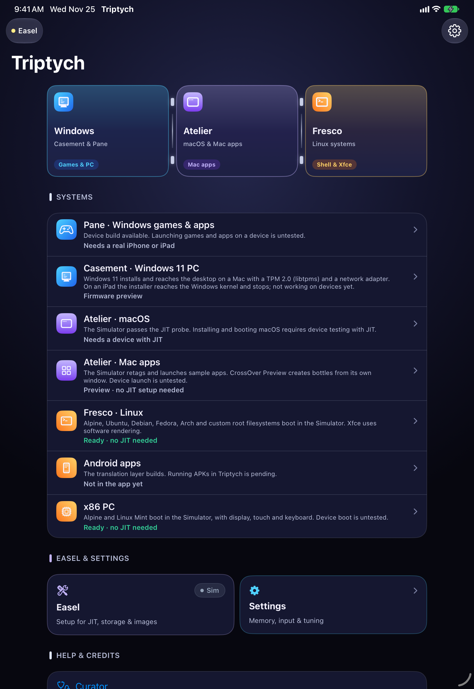<br><sub><b>Home</b></sub></td>
    <td align="center" width="33%">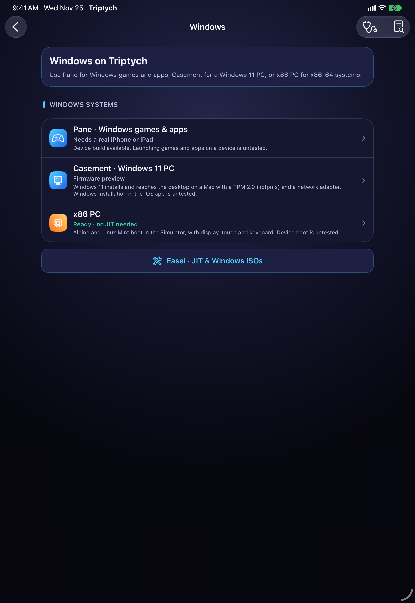<br><sub><b>Windows: Pane, Casement, x86 PC</b></sub></td>
    <td align="center" width="33%">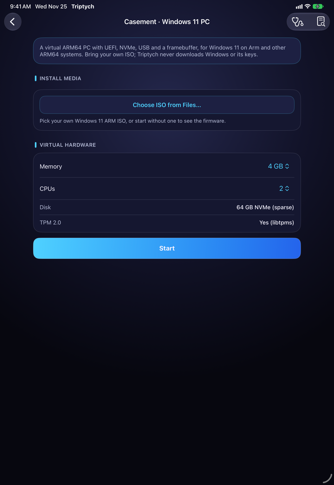<br><sub><b>Casement: bring your own ISO</b></sub></td>
  </tr>
  <tr>
    <td align="center">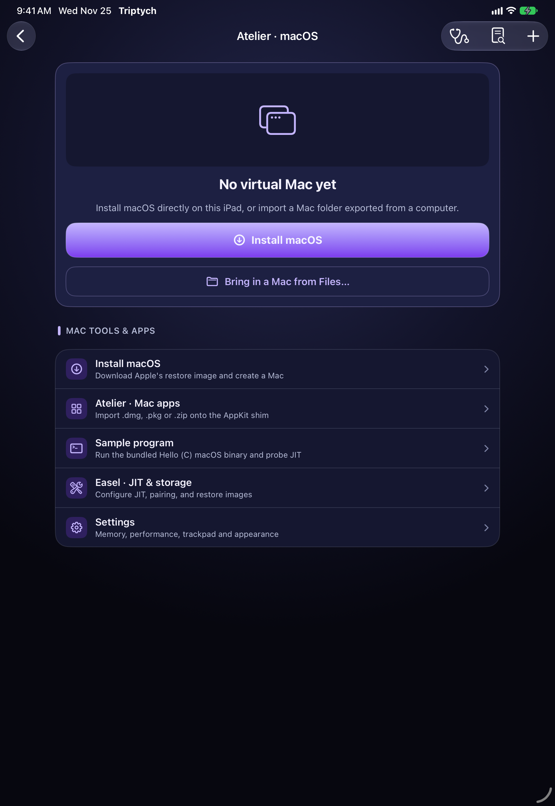<br><sub><b>Atelier: macOS</b></sub></td>
    <td align="center">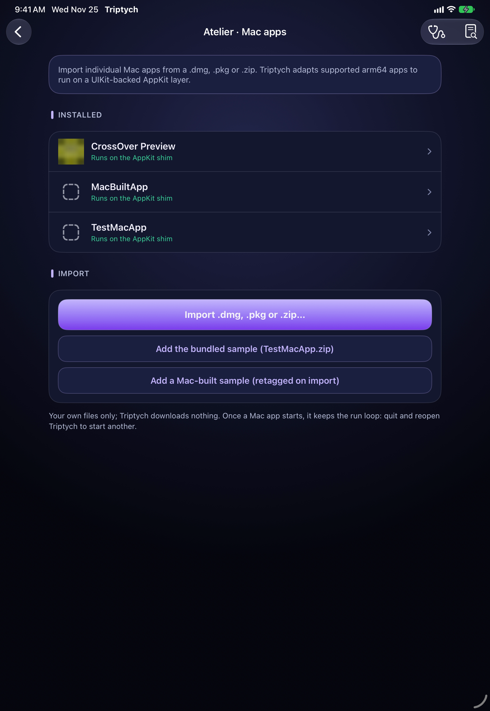<br><sub><b>Atelier: imported Mac apps</b></sub></td>
    <td align="center">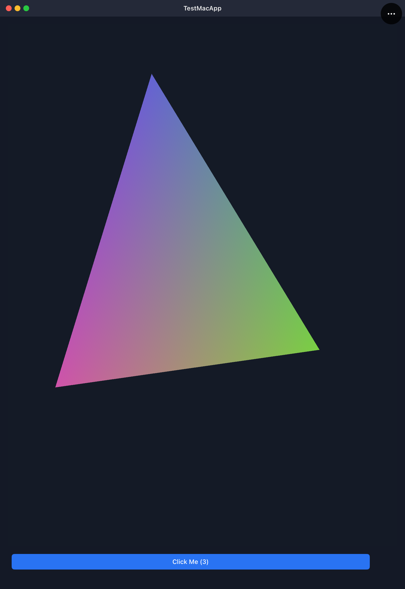<br><sub><b>A Mac app (AppKit + Metal) running</b></sub></td>
  </tr>
  <tr>
    <td align="center">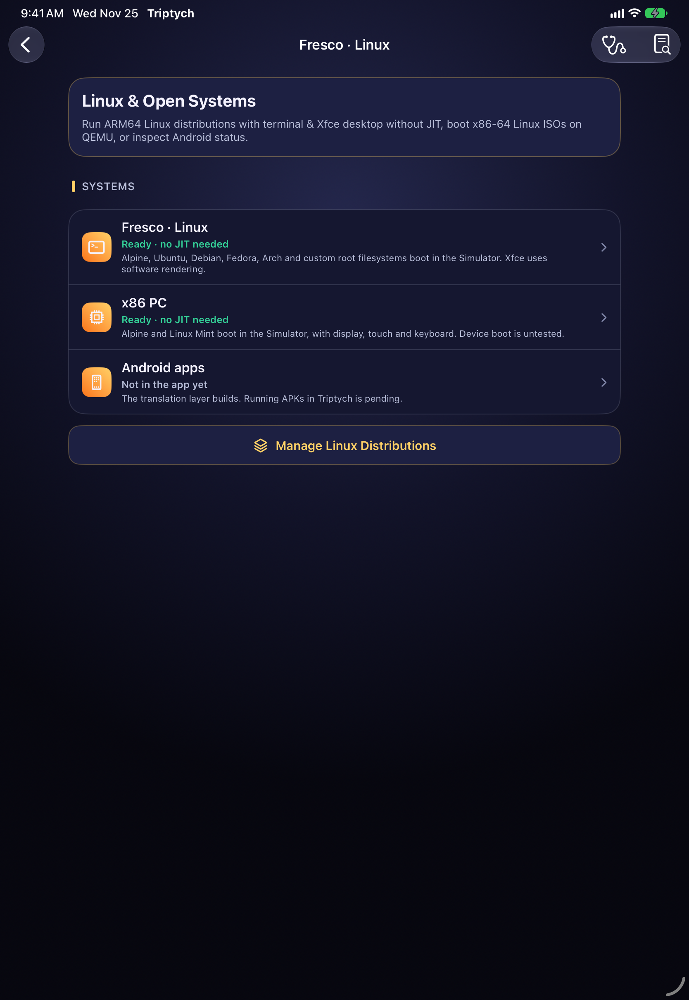<br><sub><b>Fresco: Linux</b></sub></td>
    <td align="center">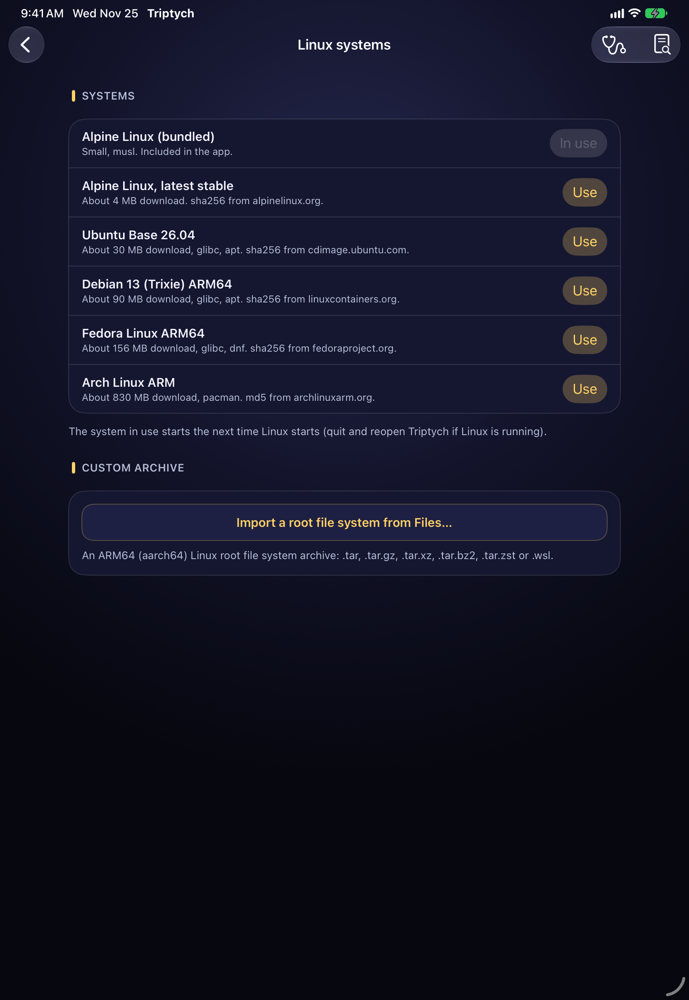<br><sub><b>Fresco: distributions</b></sub></td>
    <td align="center">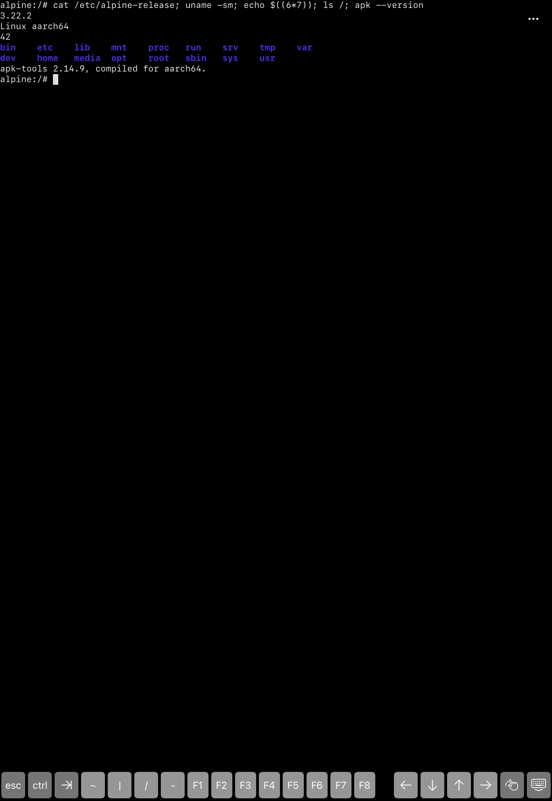<br><sub><b>Fresco: Alpine shell</b></sub></td>
  </tr>
  <tr>
    <td align="center">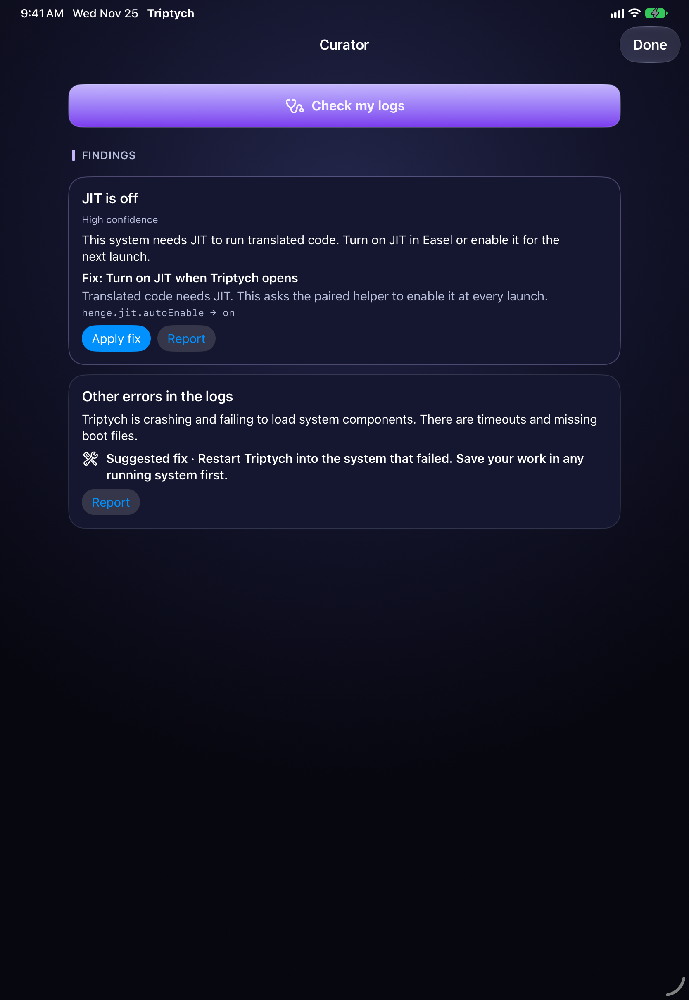<br><sub><b>Curator: a known failure, one-tap fix</b></sub></td>
    <td align="center">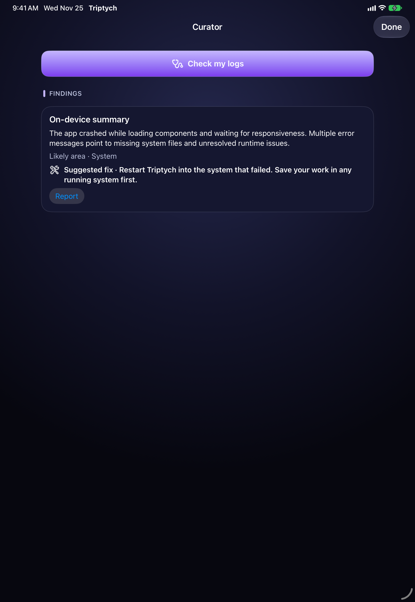<br><sub><b>Curator: on-device model summary</b></sub></td>
    <td align="center">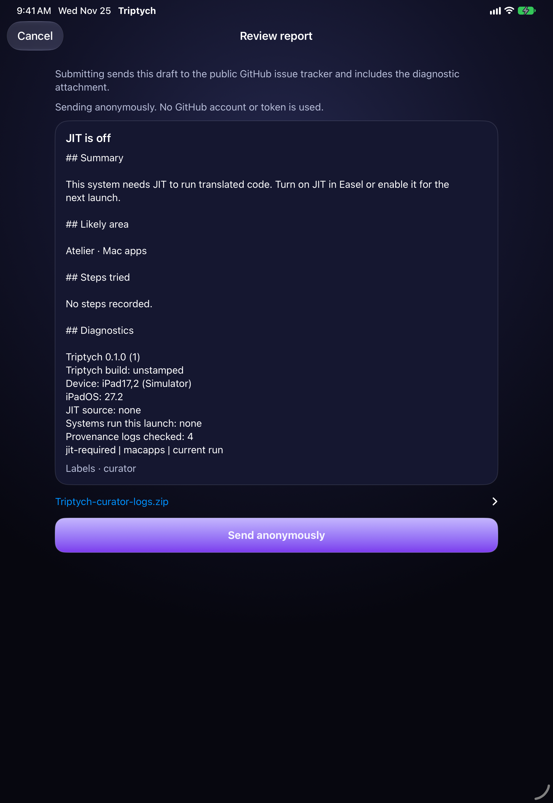<br><sub><b>Reporting: review before sending</b></sub></td>
  </tr>
  <tr>
    <td align="center">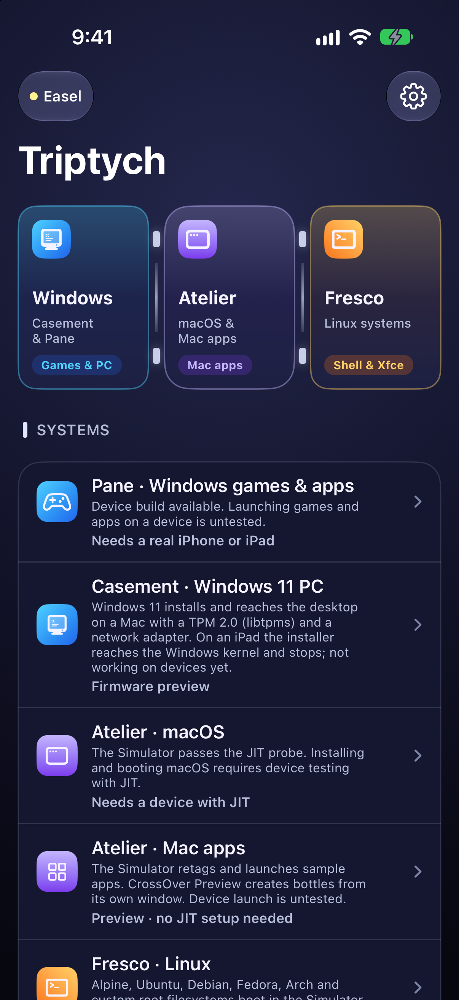<br><sub><b>iPhone</b></sub></td>
    <td align="center" colspan="2">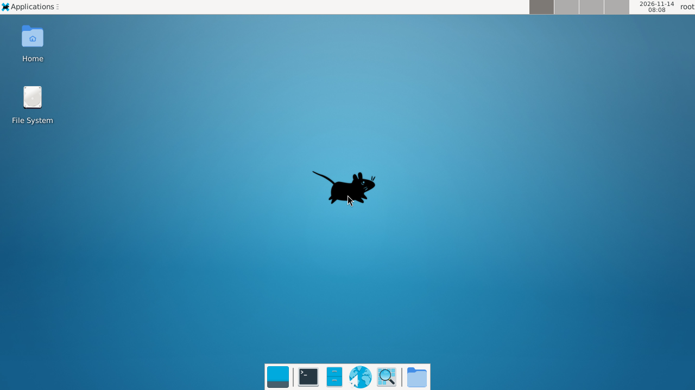<br><sub><b>Ubuntu 26.04 with Xfce on Fresco's engine</b> (Mac build of the engine, software rendering)</sub></td>
  </tr>
</table>

## Install the 0.1.0 preview

The preview is an **unsigned IPA** on the [Releases page](https://github.com/RageMC/triptych/releases)
(`Triptych-0.1.0-unsigned.ipa`). You sign and install it yourself:

1. Sign it with your own Apple ID in a sideloading tool (SideStore, AltStore, Sideloadly or Xcode), or add it to
   [LiveContainer](https://github.com/LiveContainer/LiveContainer) and use its Launch with JIT. A free Apple ID
   works, but its signature expires after 7 days. The IPA has four App IDs (the app, two JIT helpers and a memory
   host); keep `get-task-allow`, and add Increased Memory Limit if your account allows it.
2. **Fresco (Linux) and the x86 PC run without JIT.** Open Fresco and tap Start.
3. **Casement, Pane and Atelier's macOS need JIT**, which iOS only allows while a debugger is attached: use
   [StikDebug](https://github.com/StikDebug/StikDebug) with a pairing file, then enable JIT from Triptych's Easel
   screen.
4. Bring your own media. Triptych never bundles Windows, macOS, Apple firmware, keys or activation workarounds:
   Casement needs your own Windows 11 ARM64 ISO, and Atelier's macOS downloads Apple's restore image straight
   from Apple's servers when you choose a version (about 43 GB free space).

Because JIT needs a debugger, Triptych cannot be offered on the App Store. The step-by-step guide for testers is
[docs/USER-GUIDE.md](docs/USER-GUIDE.md).

## Curator: on-device help

Curator reads the current and previous run's logs (Provenance) and explains failures it recognises, such as JIT
being off, firmware that cannot find a boot disk or a Windows driver that fails to load. Where a fix is a setting
or a restart into another system, it offers an **Apply** button.

For errors no rule matches, an on-device model writes a short summary and picks one fix from a fixed list:

- **Apple Intelligence** (Foundation Models) on iOS 26 or later where it is available, or
- **Qwen3-0.6B** (Q4_K_M, about 400 MB, SHA-256 verified) through llama.cpp, downloaded only when you ask for it
  in Easel and used only when the app has enough free memory.

Nothing leaves the device unless you send a report. Both models ran on a real (scrubbed) device log in the iPad
Simulator; inference on a physical device is unverified.

## Reporting problems

From Curator, **Report** shows the exact issue text and the log attachment before anything is sent. Personal data
(user names, paths, emails, device names and identifiers, tokens, LAN addresses) is scrubbed first.

- **Signed in:** sign in with GitHub (device code) and the report is filed as you in
  [RageMC/triptych-issues](https://github.com/RageMC/triptych-issues). You can sign out in Settings.
- **Anonymous:** no account needed. Reports go through Triptych's relay, which files them in the same tracker
  under the Triptych Curator Relay app.

You can also open an issue there directly; attach the zip from **Export logs**.

## Build from source

On a Mac with Xcode 27 or later:

```sh
git clone --recurse-submodules --shallow-submodules https://github.com/RageMC/triptych.git
cd triptych
brew install cmake lld xcodegen libslirp
scripts/build-linux-engine.sh iphonesimulator
scripts/build-henge-deps.sh iphonesimulator
scripts/build-macos-engine.sh iphonesimulator
scripts/build-edk2.sh                         # Casement firmware
scripts/build-libtpms-ios.sh iphonesimulator
scripts/build-winvm.sh iphonesimulator
scripts/build-curator-llama.sh iphonesimulator
scripts/fetch-starter-rootfs.sh
make -C engines/gesso build/tl-samples.dmg
(cd app && xcodegen generate)                 # then build the Triptych scheme in Xcode
```

`scripts/package-ipa.sh` builds every engine for devices and writes `dist/Triptych-unsigned.ipa`. Build scripts
map your home folder out of compiler paths, and packaging strips debug maps and refuses to produce an IPA that
still contains your home path or user name. The guest vDSO must be linked with `ld.lld` (`brew install lld`).

Architecture and the role of each upstream: [docs/ARCHITECTURE.md](docs/ARCHITECTURE.md).
Known upstream issues and workarounds: [docs/KNOWN-FIXES.md](docs/KNOWN-FIXES.md).

## Credits and licence

Triptych is a combined work built on other people's open-source projects, each keeping its own licence and
copyright: [Henge](https://github.com/Leviidev/Henge) (Gesso), [Madeira](https://github.com/willfaust/Madeira) and
[BCD](https://github.com/thebcd69/bcd-games) (Pane), [LinuxRunner](https://github.com/mxhm11cr/LinuxRunner) (Fresco),
QEMU, EDK2, Wine, FEX-Emu, libtpms, Perl, llama.cpp, Qwen and more. Every author, licence and link is in
[CREDITS.md](CREDITS.md).

Triptych is licensed **GPL-3.0-or-later** as a combined work ([LICENSE](LICENSE)). Engines keep their own terms:
Henge GPL-2.0-or-later, Madeira GPL-3.0-or-later with the Madeira Converter Exception, BCD GPL-3.0-only with its
§7 terms, LinuxRunner/iSH GPL-3.0.

The source tree contains nothing proprietary: no macOS, Apple firmware or restore images, no Windows images or
keys, no CodeWeavers or D3DMetal binaries and no Valve binaries. Release IPAs bundle one Apple library, the Metal
Shader Converter runtime (`libmetalirconverter.dylib`, under Apple's licence), for DirectX 12. Names such as Windows, macOS and CrossOver belong to
their owners and are used only to say what Triptych works with.

### How it was built

Triptych's own code, scripts and docs were written by AI (Claude Code with Claude Opus 5.5, plus other models
for self-contained pieces), directed by RageMC. [docs/HOW-IT-WAS-BUILT.md](docs/HOW-IT-WAS-BUILT.md) explains
the process and how the work was checked.

## Support

If Triptych is useful to you: [Ko-fi](https://ko-fi.com/ragemc) · [Buy Me a Coffee](https://buymeacoffee.com/RageMC)
